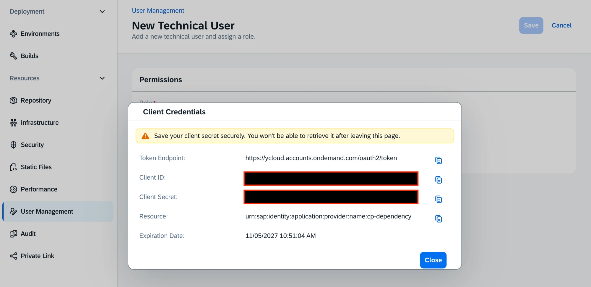

# SAP Commerce Cloud – Certificate Exchange (`certtool`)

A tool to automate the exchange of SSL certificates in **SAP Commerce Cloud (CCv2)**.
It exclusively uses the official **SAP Commerce Cloud Management CLI** (`sapccm`) and manages the
certificates and their assignment to environments/endpoints through a configuration file kept in
your repository.

---

## 1. Goal

Replacing a certificate in the Cloud Portal is a manual and error-prone process: upload the
certificate, assign it to every endpoint of every environment, clean up the old certificates.
This project automates the process and makes it reproducible:

| Step | Command | What happens |
|---|---|---|
| **Fetch** | `cxdev-certificates fetch [environment] [--apply]` | Reads environments, endpoints and their domains from the portal and adds endpoints that are missing in the configuration. Existing entries are never changed. Without `--apply` only a preview is shown. |
| **Upload** | `cxdev-certificates upload [--apply]` | Checks which configured certificates are missing in the subscription and uploads only those (idempotent). Without `--apply` only a preview is shown. |
| **Rollout** | `cxdev-certificates rollout <environment> [--apply]` | Assigns the configured certificates to the endpoints of **one** environment passed as parameter. Endpoints that already use the right certificate are left untouched. Without `--apply` only a preview is shown. |
| **Cleanup** | `cxdev-certificates cleanup [--include-unused] [--apply]` | Removes certificates that are no longer needed. With `--include-unused` it also removes configured certificates that are not assigned to any endpoint. SAP-managed certificates, certificates on the protection list and certificates still in use are never deleted. |
| **Status** | `cxdev-certificates status [environment]` | Shows local certificates, uploaded certificates and, per environment, the certificate **actually assigned** to each endpoint compared with the configured target. Read-only. |

Principles:

- **Configuration instead of click paths** – environments, endpoints and certificates are versioned
  in `certtool.json`.
- **Local data stays local** – `certtool.json` holds the technical user's credentials next to
  the subscription code, and `certificates/` holds private keys. Both are excluded from version
  control and must never be shared.
- **Safe by default** – upload, rollout and cleanup only show a preview; changes are made only
  with `--apply`.

## 2. Background

- **Certificates belong to the subscription**, not to an environment. An uploaded certificate is
  visible to all environments of the subscription (`sapccm certificate list/create/delete`).
- **A certificate becomes effective through an endpoint.** Every endpoint (e.g. storefront,
  backoffice, API) of an environment references exactly one SSL certificate
  (`sapccm endpoint update --ssl-certificate=<code>`).
- For the upload a certificate consists of up to **three PEM files**: certificate, unencrypted private
  key and the CA chain (intermediate certificates). The Cloud Portal verifies the certification path,
  so the chain is required unless the certificate is self-signed.
- The portal assigns a **certificate code** on upload. The tool identifies certificates by their
  **name**; the name in the configuration must therefore be unique within the subscription.
- A certificate that is still assigned to an endpoint cannot be deleted. The tool checks this itself
  (`ENDPOINTS COUNT`) and skips such certificates.

### Recommended process for a certificate exchange

```
add new certificate ─► config: adjust certificates + endpoints
        │
        ▼
upload (preview) ─► upload --apply  (once per subscription)
        │
        ▼
rollout d1 (preview) ─► rollout d1 --apply ─► verify ─► same for s1, p1
        │
        ▼
remove old certificate from config ─► cleanup (preview) ─► cleanup --apply
```

1. Add the new certificate under a **new, descriptive name** (e.g. `www-example-com-2026`), see
   [section 6](#6-storing-certificates).
2. In `certtool.json`, add the certificate under `certificates` and point the endpoints of the
   affected environments to the new name.
3. `cxdev-certificates upload` – shows the upload preview incl. local checks, then
   `cxdev-certificates upload --apply` uploads the new certificate.
4. `cxdev-certificates rollout d1` – shows which endpoints would be switched, then
   `cxdev-certificates rollout d1 --apply` switches them. Roll out to a development environment first
   and verify, then stage and production.
5. Remove the old certificate from `certificates`, run `cxdev-certificates cleanup` as a preview and
   then delete with `--apply`.

## 3. Requirements

| Component | Version / note |
|---|---|
| Java | 21 or newer – required by both certtool and sapccm. SapMachine 21 is recommended. |
| JSON | Gson, included in the release package under `lib/`. |
| OpenSSL | Optional, recommended. Used for local certificate checks (expiry date, key matches certificate). |
| SAP CLI | Not included (proprietary SAP software), see [Installing the SAP CLI](#installing-the-sap-cli). |
| Technical user | For the subscription, with access to the required environments (see below). |

### Installing the SAP CLI

1. Download the **SAP Commerce Cloud Management CLI** from
   [SAP Software Downloads](https://me.sap.com/softwarecenter) (search for `CX COMM CLOUD MAN CLI`).
2. Place the ZIP file (e.g. `CXCOMMCLI00P_42-80005133.ZIP`) in the `tools/` directory.
3. If `sapccm` is not yet installed, `certtool` extracts the ZIP to `tools/sapccm/`.

In a CXDEV environment, `certtool` also searches `$CXDEVHOME/dependencies/sapccm/` and sibling
directories whose names start with `sapccm`, including their subdirectories. This search is a
fallback when the certtool ZIP directory (`tools/` by default, configurable via `sapccmZipDir`)
contains no `CXCOMMCLI*.ZIP` archive. The shared archive stays in place.

Both the ZIP file and the extracted CLI are excluded from version control via `.gitignore`. A CLI
installed elsewhere can be referenced with `sapccmHome` in the configuration.

### Installing certtool once, using it in many projects

The tool is installed once; each project only contains its own configuration and certificates:

```
~/tools/certtool/              # this repository (incl. tools/ with the SAP CLI)
~/projects/customer-a/
├── certtool.json              # configuration incl. credentials (chmod 600)
└── certificates/              # certificates of this project
~/projects/customer-b/
├── certtool.json
└── certificates/
```

Put `cxdev-certificates` on your `PATH`, e.g. with a symlink (the script resolves symlinks to find its
installation). Download the ZIP from [GitHub Releases](https://github.com/cxdevtools/certificate-exchange/releases/latest); it contains the application and required libraries in `lib/`:

```bash
ln -s ~/tools/certtool/bin/cxdev-certificates ~/.local/bin/cxdev-certificates
```

On **Windows**, use `bin\cxdev-certificates.bat` and add the `bin` directory of the installation to
the user `PATH` (symlinks are not needed), e.g. via *Settings → "Edit environment variables for your
account" → Path → New* (`C:\tools\certtool\bin`). Avoid `setx PATH "%PATH%;…"`: it truncates long
values and copies the system PATH into the user PATH. The wrapper uses `%JAVA%` if set, otherwise `java` from `PATH`.

Then run it inside a project directory:

```bash
cd ~/projects/customer-a
cxdev-certificates status
```

`certtool` reads `certtool.json` from the **current directory**. With `--config <file>` another file
can be used; relative paths in it (`certificatesPath`) are always resolved **relative to the
configuration file**, never to the current directory.

### JVM warnings of the SAP CLI

The SAP CLI bundles netty, which makes newer JVMs print warnings (`sun.misc.Unsafe`,
`System::loadLibrary`) and logs a DNS message on macOS. `certtool` suppresses them at the source by
adding JVM options matching the detected Java version (and additionally filters any remaining noise):

| Option | Silences | Java |
|---|---|---|
| `-Dlogging.level.io.netty=OFF` | `Unable to load io.netty.resolver.dns.macos...` | all |
| `--enable-native-access=ALL-UNNAMED` | `A restricted method in java.lang.System has been called` | 21+ |
| `--sun-misc-unsafe-memory-access=allow` | `A terminally deprecated method in sun.misc.Unsafe has been called` | 23+ (aborts the JVM on 21) |

For manual `sapccm` calls on Java 23+ you can use the same options:

```bash
export JAVA_OPTS="-Dlogging.level.io.netty=OFF --enable-native-access=ALL-UNNAMED --sun-misc-unsafe-memory-access=allow"
```

On Java 21/22 omit `--sun-misc-unsafe-memory-access=allow`.

## 4. Creating a technical user

The CLI authenticates via OAuth2 client credentials using a **technical user** of the Cloud Portal
(SAP documentation: [Creating a Technical User](https://help.sap.com/docs/SAP_COMMERCE_CLOUD_PUBLIC_CLOUD/0c2050f6d31f49ddb6eba18509060ae5/62a9658887d04f89b3084912b3c711c4.html)).

1. In the Cloud Portal side navigation, open **User Management**.
2. Select **Technical Users** and click **Create**.
3. Set the **Permissions**:
   - **Role:** `CUSTOMER_SYS_ADMIN` or `CUSTOMER_DEVELOPER`. Managing certificates and endpoints most
     likely requires `CUSTOMER_SYS_ADMIN` (see [Open points](#11-open-points)).
   - **Environment Access:** select the environments the tool may access.
4. Confirm with **Create** or **Save**.
5. The **Client Credentials** dialog appears. Store the values securely **right away** (e.g. in a
   password manager) – the client secret cannot be retrieved after leaving the page.



Every field of the dialog maps to a field of the `credentials` block in `certtool.json`
(see [section 5](#5-providing-the-credentials)):

| Dialog field | Configuration field | Required | Usage |
|---|---|---|---|
| Token Endpoint | `tokenEndpoint` | yes | CLI `token-url` (SAP placeholder `TOKEN_URL_VALUE`) |
| Client ID | `clientId` | yes | CLI `client-id` (`CLIENT_ID_VALUE`) |
| Client Secret | `clientSecret` | yes | CLI `client-secret` (`CLIENT_SECRET_VALUE`) |
| Resource | `clientResource` | no | not required by the CLI, kept for completeness |
| Expiration Date | `clientExpires` | no | **checked before every run**, see below |

The secret expires (6 months according to the SAP documentation) – create a new one in the portal in
good time.

## 5. Providing the credentials

The credentials are stored in the local configuration `certtool.json`, next to the
subscription code. The file is installation specific, excluded from version control (`.gitignore`)
and must never be shared – just like the private keys in `certificates/`.

```json
{
  "subscriptionCode": "abc123",
  "credentials": {
    "tokenEndpoint": "https://ycloud.accounts.ondemand.com/oauth2/token",
    "clientId": "<Client ID>",
    "clientSecret": "<Client Secret>",
    "clientResource": "urn:sap:identity:application:provider:name:cp-dependency",
    "clientExpires": "11/05/2027 10:51:04 AM"
  },
  "environments": {
    "p1": {
      "credentials": {
        "clientId": "<Client ID of a separate production user>",
        "clientSecret": "<Client Secret>",
        "clientExpires": "11/05/2027 10:51:04 AM"
      },
      "endpoints": { }
    }
  }
}
```

Protect the file so that only you can read it:

```bash
chmod 600 certtool.json
```

`certtool` prints a warning if the file is accessible by other users. Secret values are never
printed; the context header only shows which block is used (e.g. `credentials` or
`environments.p1.credentials`).

**Lookup order:**

- `rollout <env>` uses `environments.<env>.credentials` if it defines a `clientId`, otherwise the
  subscription wide `credentials`. `status` and `fetch` do the same for every environment they read.
  `upload` and `cleanup` always use the subscription wide `credentials`.
- The block is selected by `clientId`: `clientSecret` and `clientExpires` are only taken from the same
  block, so the id and secret of different technical users are never mixed. An environment block
  with `clientSecret`/`clientExpires` but without `clientId` is rejected.
- `tokenEndpoint` is the same for all users and falls back to the subscription wide block.

### Expiration date check

If `clientExpires` is set in the selected block, `certtool` checks the date **before the first CLI
call**:

- expired → abort with exit code 2, nothing is executed,
- valid for less than 14 days → warning, the run continues,
- not set → no check.

The value is **copied 1:1 from the portal dialog**. The portal displays the date as **DD/MM/YYYY hh:mm:ss AM/PM**: `11/05/2027 10:51:04 AM` means
**11 May 2027** (6 months after creation). The date without time (`11/05/2027`) and ISO 8601
(`2027-05-11`) are accepted as well.

Should the portal ever provide the date in a different format, it can be set in the configuration,
e.g. `"credentialsExpiresFormat": "M/d/uuuu h:mm:ss a"` (Java date format syntax).

### How the credentials are passed to the CLI

`sapccm config set ...` would store the credentials permanently and in plain text in
`~/.config/sapccm/config.properties` (Windows: `%LOCALAPPDATA%\sapccm\config.properties`).
`certtool` avoids this: for every run it creates a private temporary directory (permissions
`0700`/`0600`), redirects the CLI to it via `-Duser.home=<temp>` or `LOCALAPPDATA=<temp>`, and deletes
the directory at the end. An existing global sapccm configuration is neither read nor modified. The
secrets also never appear on the command line (`ps`).

## 6. Storing certificates

One directory per certificate below `certificates/`, named like the certificate in the configuration:

```
certificates/
└── www-example-com-2026/
    ├── certificate.pem   # server certificate (PEM)
    ├── private-key.pem   # private key, unencrypted (PEM) – NOT committed
    └── ca-chain.pem      # intermediate certificates (PEM) – may also be appended to certificate.pem
```

File names and directory can be overridden per certificate in the configuration (`directory`,
`certificate`, `privateKey`, `caChain`).

> **Security:** Private keys are excluded from version control via `.gitignore`. They should only be
> stored locally for the duration of the upload, or be provided from a secure store (password
> manager, vault). After a successful upload the tool no longer needs them.

Before uploading, the tool checks locally: the name only contains printable ASCII
characters (the Cloud Portal rejects e.g. umlauts with "value contains invalid characters"), files exist
and are in PEM format, key is not password protected, certificate is not expired (warning < 30 days), private key matches the certificate, and –
if present – the CA chain is readable, and that a CA chain exists for certificates that are not
self-signed.

**CA chain:** The Cloud Portal verifies the certification path of an uploaded certificate. A leaf
certificate without its intermediates is rejected with `Certification path could not be verified.
Current path: CN=...`. Provide the intermediate certificate(s) of your CA in one of two ways:

- as a separate `ca-chain.pem` (as delivered by the CA, e.g. "CA bundle"/"intermediate"), or
- as a **full chain** in `certificate.pem` (leaf first, followed by the intermediates, e.g. Let's
  Encrypt's `fullchain.pem`). `certtool` splits the file before the upload: the first certificate is
  uploaded as certificate, the rest as CA chain (plus `ca-chain.pem`, if present).

**What goes into `ca-chain.pem`:** all intermediate certificates between your certificate and the
root CA, concatenated into **one** PEM file. Start with the certificate that issued your certificate,
then add each further intermediate up to the root. Your own certificate does not belong in this file.
The root certificate is usually not needed because the portal already trusts it. Add it at the end
only if the portal still reports `Certification path could not be verified`.

CAs often deliver the chain as separate files. Example for a Sectigo certificate:

| File delivered by the CA | Role | Where it goes |
|---|---|---|
| `STAR_example_com.crt` | your certificate (leaf) | `certificate.pem` |
| `SectigoPublicServerAuthenticationCADVR36.crt` | intermediate, issued your certificate | `ca-chain.pem` (1st) |
| `SectigoPublicServerAuthenticationRootR46_USERTrust.crt` | intermediate (cross-signed root) | `ca-chain.pem` (2nd) |
| `USERTrustRSACertificationAuthority.crt` | root CA | usually omitted |

Combine the intermediates in this order:

```bash
cat SectigoPublicServerAuthenticationCADVR36.crt \
    SectigoPublicServerAuthenticationRootR46_USERTrust.crt > certificates/<name>/ca-chain.pem
grep -c "BEGIN CERTIFICATE" certificates/<name>/ca-chain.pem   # expected: 2
```

If `grep` prints `0`, the `.crt` files are in binary DER format. Convert each file to PEM first
(`openssl x509 -inform der -in <file>.crt >> certificates/<name>/ca-chain.pem`).
`openssl x509 -in <file>.crt -noout -subject -issuer` shows the subject and issuer of each file.
Every issuer should be the subject of the next certificate in the chain.

`certtool` blocks the upload of a non-self-signed certificate without any chain locally ("CA chain
missing") and shows the issuer whose intermediates are needed. Self-signed certificates are uploaded
without chain: `sapccm certificate create` requires `--ca-certificate-path` and rejects empty files,
so a temporary file containing only a line break is passed. Split and helper files live in the run's
private temporary directory and are deleted afterwards.

**Naming convention:** The name should identify the certificate uniquely and reflect its validity,
e.g. `<domain>-<year>`. A new certificate always gets a **new** name – only then can it be uploaded
next to the old one and rolled out step by step.

## 7. Configuration

The configuration is `certtool.json` in the project directory (the current directory; template:
[`certtool.example.json`](certtool.example.json)). It contains the technical user's credentials and
must never be shared or committed – in this repository `certtool.json` and `certificates/*` are
listed in `.gitignore`. A different file can be passed with `--config <path>`.

```json
{
  "subscriptionCode": "<SUBSCRIPTION_CODE>",
  "credentials": {
    "tokenEndpoint": "<TOKEN_ENDPOINT>",
    "clientId": "<CLIENT_ID>",
    "clientSecret": "<CLIENT_SECRET>",
    "clientExpires": "<DD/MM/YYYY hh:mm:ss AM/PM>"
  },
  "certificates": {
    "www-example-com-2026": {}
  },
  "environments": {
    "d1": {
      "description": "Development",
      "endpoints": {
        "<ENDPOINT_CODE_STOREFRONT>": {
          "domain": "www.example.com",
          "certificate": "www-example-com-2026"
        },
        "<ENDPOINT_CODE_BACKOFFICE>": "sap-managed",
        "<ENDPOINT_CODE_SOLR>": { "domain": "<DOMAIN>", "certificate": "unmanaged" }
      }
    },
    "p1": {
      "endpoints": { "<ENDPOINT_CODE_STOREFRONT>": "www-example-com-2026" }
    }
  },
  "cleanup": {
    "protectedCertificates": ["*-public - * (Let's Encrypt)", "<NAME_OR_CODE_OF_OTHER_CERTIFICATES>"]
  }
}
```

| Key | Required | Meaning |
|---|---|---|
| `subscriptionCode` | yes | Code of the subscription (see Cloud Portal URL). Also determines the names of the credential variables. |
| `credentials` | yes | Technical user of the subscription: `tokenEndpoint`, `clientId`, `clientSecret`, optional `clientResource`, `clientExpires` (see [section 5](#5-providing-the-credentials)). |
| `credentialsExpiresFormat` | no | Different strptime format for `clientExpires` (default: portal format DD/MM/YYYY hh:mm:ss AM/PM). |
| `certificatesPath` | no | Directory of the certificates, **relative to the configuration file** (or absolute), default `./certificates`. |
| `sapccmHome` / `sapccmZipDir` | no | Location of the extracted CLI (default `tools/sapccm`) or of the ZIP archive (default `tools`), relative to the **certtool installation**. |
| `certificates.<name>` | – | Certificates that should exist in the subscription. The key is the **name in the portal**. Printable ASCII only. Optional: `directory`, `certificate`, `privateKey`, `caChain`. |
| `environments.<key>` | – | Environment definition. The key is the parameter for `rollout`. |
| `environments.<key>.code` | no | Environment code in the portal, default = key (e.g. `d1`, `s1`, `p1`). |
| `environments.<key>.credentials` | no | Separate technical user for this environment (same fields as `credentials`). |
| `environments.<key>.endpoints` | – | Mapping **endpoint code → target**. Short form: `"<endpoint>": "<target>"`. Long form: `"<endpoint>": {"domain": "...", "certificate": "<target>"}`. Endpoint codes are shown in the Cloud Portal and by `sapccm endpoint list`; `fetch` fills them in. |
| `…endpoints.<code>.certificate` | – | Target: a name from `certificates`, `"sap-managed"` (SAP-managed Let's Encrypt certificate of the environment, see [SAP-managed certificates](#sap-managed-certificates)) or `"unmanaged"` (not managed by certtool, ignored by `rollout`). Missing in the long form = `unmanaged`. |
| `…endpoints.<code>.domain` | no | Desired hostname. `status` reports differences. `rollout` previews a domain change and applies it with `--apply` after verifying certificate coverage. Omit it to keep the current domain. |
| `cleanup.protectedCertificates` | no | Certificates the cleanup **never** deletes – by name or certificate code, wildcards `*`/`?` allowed. SAP-managed certificates are additionally always protected (see below). |

`certificatesPath` is resolved relative to the configuration file, `sapccmHome`/`sapccmZipDir` relative to the certtool installation.

### Filling the configuration from the portal (`fetch`)

`cxdev-certificates fetch` reads all environments of the subscription (`sapccm environment list`), their
endpoints and domains (`sapccm endpoint list`) and the certificate currently assigned to each new
endpoint (`sapccm endpoint show`). Endpoints that are **missing** in the configuration are added in the
long form; the `certificate` field is set to

- the name of the assigned certificate if it is listed under `certificates`,
- `sap-managed` if the endpoint uses the SAP-managed Let's Encrypt certificate,
- `unmanaged` otherwise – `rollout` ignores such endpoints until you set a target.

Existing endpoints and environments are **never changed** (endpoints that exist only in the
configuration are reported as `configured, but not in portal`). New environments are added with the
portal name as `description`. Without `--apply` only the plan is shown; with `--apply` the
configuration file is rewritten as JSON with 2-space indentation (key order is kept, blank lines and
custom formatting are not). Each environment is read with its own credentials, as in `status`.

```bash
cxdev-certificates fetch            # preview: which endpoints would be added
cxdev-certificates fetch --apply    # add missing endpoints of all environments
cxdev-certificates fetch d1 --apply # only environment d1
```

## 8. Usage

`cxdev-certificates` without arguments (or with `--help`) prints an overview of all commands with
examples; `cxdev-certificates <command> --help` shows the options and examples of one command.

Run all commands in the project directory, through `cxdev-certificates <command>` (on the `PATH`, see
[Installing certtool once](#installing-certtool-once-using-it-in-many-projects)) or `<install dir>/bin/cxdev-certificates <command>`
(macOS/Linux), or `cxdev-certificates <command>` via `bin\cxdev-certificates.bat` (Windows).

```bash
cxdev-certificates status                    # overview local vs. portal incl. actual endpoint certificates
cxdev-certificates status d1                 # only environment d1
cxdev-certificates upload                    # preview: what would be uploaded (incl. local checks)
cxdev-certificates upload --apply            # upload missing certificates
cxdev-certificates upload --certificate www-example-com-2026 --apply
cxdev-certificates rollout d1                # preview: which endpoints would be switched
cxdev-certificates rollout d1 --apply        # switch environment d1
cxdev-certificates rollout d1 --endpoint <ENDPOINT_CODE> --apply
cxdev-certificates cleanup                   # preview: what would be deleted
cxdev-certificates cleanup --apply           # actually delete
cxdev-certificates cleanup --include-unused  # preview incl. configured certificates without endpoint
cxdev-certificates cleanup --include-unused --apply
```

Global options (before or after the command): `--config <file>`,
`-v/--verbose` (shows every `sapccm` call including its output).

### Console output

Every command starts with a **context header**, so it is always clear what the run acts on (secret
values are never shown):

```
SAP Commerce Cloud Certificate Exchange · certtool 0.2.0
  Command        rollout
  Mode           preview (use --apply to switch the endpoints)
  Configuration  certtool.json
  Subscription   20cd84081f9e41a19b71e5f699129534
  Environment    d1 (demo)
  Credentials    credentials · secret expires 2027-05-11 (180 days)
  sapccm CLI     tools/sapccm (version 20261022-112509)
  Java           25.0.4 (/Users/me/.sdkman/candidates/java/current/bin/java)
  Runtime        Java 25.0.4 · Darwin arm64
  Started        2026-11-12 14:03:11
```

Every command prints a **Plan** before contacting SAP, then shows the read steps under **Checking**.
The tables show the results of those checks. Without `--apply`, commands that can make changes
stop at the preview. With `--apply`, the individual changes and their results follow under
**Executing**. A **Details** block lists any errors before the summary.

```
Rollout plan - environment d1 (demo) (preview)
  ┌──────────┬─────────────────────────────────────────────────────┬─────────────────────────────┬──────────────┐
  │ Endpoint │ Current certificate                                 │ Target certificate          │ Action       │
  ├──────────┼─────────────────────────────────────────────────────┼─────────────────────────────┼──────────────┤
  │ jsapps   │ d1-public - 2027-02-05 (Let's Encrypt) [4irgvwbvgw] │ local.cxdev.me [7oq81mp8jq] │ would switch │
  └──────────┴─────────────────────────────────────────────────────┴─────────────────────────────┴──────────────┘

1 endpoint(s) would be switched. Use 'rollout d1 --apply' to switch them.
```

`status` prints three kinds of tables: the configured certificates (local check and upload state),
all certificates of the subscription, and per environment the certificate **actually assigned** to
every endpoint compared with the configured target:

| State | Meaning |
|---|---|
| `OK - target in place` | The endpoint already uses the configured target certificate. |
| `rollout pending` | The endpoint uses a different certificate – `rollout` would switch it. |
| `target not uploaded` / `domain not covered` / `endpoint does not exist` / `could not read endpoint` | Problem; details are listed below the tables. |
| `not configured` | The endpoint exists in the portal but is not configured; for information only. |

Each environment is queried with its own credentials (environment scope first, subscription scope as
fallback); the table heading shows which ones. `status` reads every endpoint individually
(`sapccm endpoint show`); since every sapccm call starts a JVM, this takes a few seconds per endpoint.
Use `status <environment>` to restrict it to one environment. It exits with `1` if any problem was
found, otherwise with `0`.

Tables use box drawing characters if the terminal supports UTF-8 and plain ASCII otherwise. Colors are
only used in interactive terminals; set `NO_COLOR=1` to disable them.

`upload` shows local validity and the planned action. `cleanup` adds the number of assigned
endpoints and the expiry date. `fetch` lists the environment, endpoint, domain, certificate target, and
whether the entry will be added or was already configured.

### Rules in detail

**Upload** – For every certificate in `certificates`: if a certificate with the same name exists in
the subscription, it is skipped. Otherwise it is checked locally and uploaded with
`sapccm certificate create`.

**Rollout** – For every endpoint of the environment: the target certificate must be uploaded and its
name must be unique, the endpoint must exist in the environment, and the certificate must cover the
endpoint's target domain. If the configured domain differs from the portal domain, the plan shows
both hostnames. `rollout --apply` sends `--domain-name` and `--ssl-certificate` in one
`sapccm endpoint update` call. This also works when the target certificate is already assigned and
only the domain needs changing.

**Domain check:** The Cloud Portal rejects a certificate that does not match the endpoint's domain
(`The SSL certificate '...' does not match the domain name '...'`). `certtool` therefore compares the
domain of every endpoint (column `URL` of `sapccm endpoint list`) with the DNS names of the local
certificate (subjectAltName, CN as fallback; `*.example.com` covers exactly one label, e.g.
`www.example.com` but not `a.b.example.com`). Endpoints that do not match are shown as
`blocked - domain not covered` (status: `domain not covered`) and are not changed. The check is
skipped if the domain or the local certificate file is not available.

Before changing a domain, certtool requires a valid hostname and checks it against the uploaded
certificate's `DOMAINS` from `sapccm certificate show`. For a configured custom certificate, the
local leaf PEM must also cover the hostname. Missing or unreadable coverage blocks the change.
`unmanaged` endpoints are skipped. Prepare the DNS record for the new hostname before applying the
rollout.

**Cleanup** – Every certificate of the subscription is classified:

| Status | Condition | Action |
|---|---|---|
| `SAP-managed` | name contains "Let's Encrypt" (built in, independent of the configuration) | kept |
| `configured` | name is listed in `certificates` | kept (see `--include-unused`) |
| `configured, unused` | only with `--include-unused`: listed in `certificates`, assigned to **no** endpoint and not protected | deleted with `--apply` |
| `protected` | name or code matches `cleanup.protectedCertificates` | kept |
| `in use` | still assigned to endpoints | kept, with a hint |
| `deletable` | everything else | deleted with `--apply` |

`--include-unused` removes every certificate that is not assigned to an endpoint, even if it is still
valid and listed in the configuration. SAP-managed and protected certificates are kept as usual.
A configured certificate that was uploaded but not rolled out yet is deleted too; the next
`upload --apply` uploads it again. Always check the preview before running with `--apply`.

### SAP-managed certificates

SAP automatically provides and renews Let's Encrypt certificates for every environment. They follow
the naming pattern `<environment ID>-public - <expiry date> (Let's Encrypt)`, e.g.

- `d1-public - 2026-11-19 (Let's Encrypt)`
- `d1-public - 2027-02-05 (Let's Encrypt)`

These certificates are managed by SAP and **always excluded from cleanup**: if the name contains
"Let's Encrypt" (case-insensitive, typographic apostrophe allowed), the certificate is never deleted –
even if the configuration is missing or wrong. For documentation purposes, the pattern
`*-public - * (Let's Encrypt)` is also listed under `protectedCertificates` in the example
configuration. Your own certificates should therefore not contain "Let's Encrypt" in their name,
otherwise the cleanup will never remove them.

**Switching an endpoint back to the SAP-managed certificate:** Because name and code of the
SAP-managed certificate change with every renewal, it cannot be referenced by name. Use the reserved
target `"sap-managed"` instead:

```json
"environments": {
  "d1": {
    "endpoints": {
      "jsapps": "www-example-com-2026",
      "backoffice": "sap-managed"
    }
  }
}
```

- `rollout` assigns the **newest** SAP-managed certificate of the environment (name starts with
  `<environment code>-public`, latest expiry date).
- An endpoint that already uses **any** SAP-managed certificate of the environment counts as
  "already in place" – SAP renews and reassigns these certificates itself, `certtool` does not
  interfere.
- If the environment has no SAP-managed certificate, the endpoint is reported as
  `no SAP-managed certificate for '<env>' found` and not changed.
- `sap-managed` cannot be used as the name of an own certificate.

### Exit codes

`0` success · `1` errors for individual certificates/endpoints or sapccm errors · `2` configuration or
usage errors (e.g. missing or expired credentials).

## 9. Project structure

```
├── bin/cxdev-certificates     # shell entry point: cxdev-certificates <command> [...] (symlink it into the PATH)
├── bin/cxdev-certificates.bat # the same for Windows (add bin\ to the PATH)
├── src/main/java/me/cxdev/certtool/ # Java application (Java 21+)
├── certificates/              # certificates when this directory is used as project directory (not versioned)
├── certtool.example.json      # template for certtool.json in a project directory
├── docs/images/               # images used in the documentation
├── test/java/                 # JUnit tests
├── lib/                       # release JAR and downloaded runtime libraries
└── tools/                     # place the SAP CLI ZIP here (not versioned)
```

## 10. sapccm commands used

The CLI provides no machine-readable output (no JSON); `certtool` parses the ASCII tables using the
column headers.

| Command | Purpose |
|---|---|
| `certificate list --subscription-code` | Existing certificates incl. `ENDPOINTS COUNT` |
| `certificate create --subscription-code --name --certificate-path --certificate-key-path --ca-certificate-path` | Upload (`--description` is not used) |
| `certificate delete --subscription-code --certificate-code` | Cleanup |
| `environment list --subscription-code` | Environments of the subscription (`fetch`) |
| `endpoint list --subscription-code --environment-code` | Check that endpoints exist, domain of each endpoint (`URL`) |
| `endpoint show --subscription-code --environment-code --code` | Current `SSL CERTIFICATE` of the endpoint |
| `certificate show --subscription-code --certificate-code` | Check the uploaded certificate's DNS names before a domain change |
| `endpoint update --subscription-code --environment-code --code --ssl-certificate [--domain-name]` | Rollout |

SAP documentation of the CLI: [Commerce Cloud Command Line Interface](https://help.sap.com/docs/SAP_COMMERCE_CLOUD_PUBLIC_CLOUD/9116f1cfd16049c3a531bfb6a681ff77/8acde53272c64efb908b9f0745498015.html).

## 11. Open points

The following points still need to be verified against a real environment:

1. **Technical user role:** Is `CUSTOMER_DEVELOPER` sufficient for certificates and endpoints, or is
   `CUSTOMER_SYS_ADMIN` required?
2. **Effect of `endpoint update`:** Does the certificate change take effect immediately, or is a
   deployment or an "apply" in the portal required?
3. **Self-signed certificates:** The portal rejects a CA-signed leaf without intermediates
   ("Certification path could not be verified"). Whether it accepts a self-signed certificate with
   an empty CA chain has not been verified.
4. **Allowed characters in names:** Umlauts were rejected by the portal (in the description field);
   `.`, `-` and spaces are accepted in names. The exact server-side rule is not documented – `certtool` therefore only
   allows printable ASCII.
5. **mTLS certificates** (`--mtls-certificate-code`) are currently not covered.

## 12. Tests

```bash
gradle test
gradle releaseZip
```

Tests are implemented with JUnit 5. `gradle releaseZip` builds a ZIP containing the application JAR,
runtime libraries and both launchers. Publishing a GitHub release automatically attaches this ZIP as
`certtool-<version>.zip`.

Set the local build version in `gradle.properties` (`releaseVersion=…`). The release workflow uses
the tag as the build version. Before releasing, update [RELEASE_NOTES.md](RELEASE_NOTES.md) on the
commit you want to tag. Pushing a version tag such as `0.2.1` or `v0.2.1` builds the ZIP, runs the
tests and publishes a GitHub release titled `Release 0.2.1` with those notes and the ZIP attached.

## License

Copyright 2026 cxdevtools

Licensed under the [Apache License, Version 2.0](LICENSE). The SAP Commerce Cloud Management CLI is
proprietary SAP software; it is not part of this project and not covered by this license.
